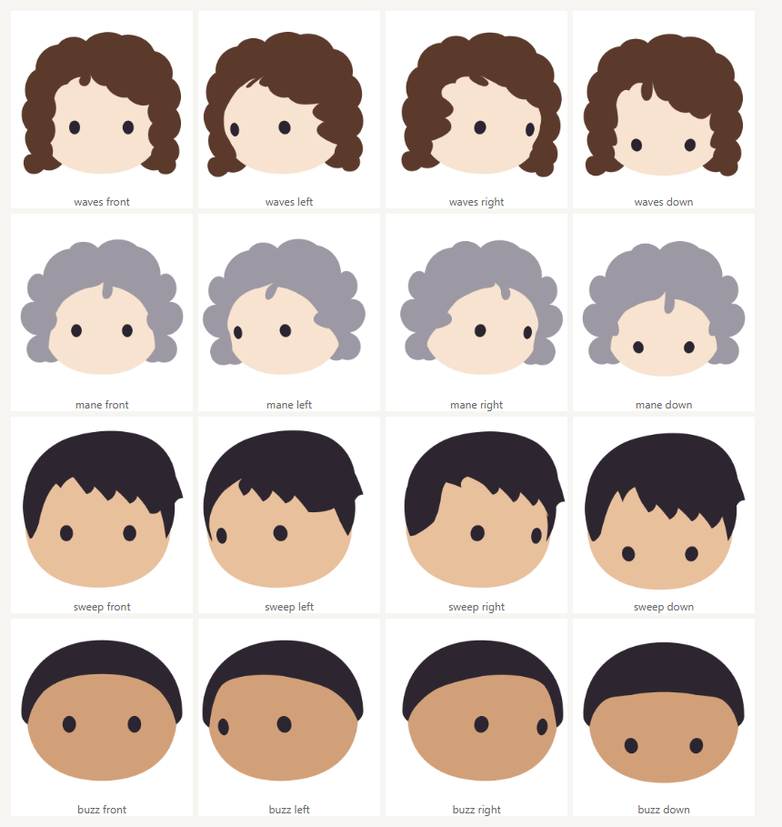
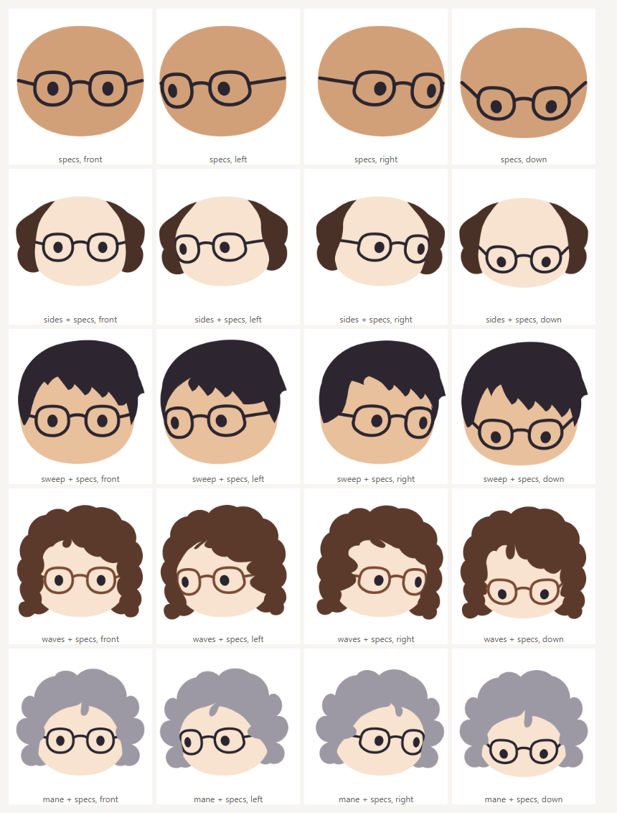
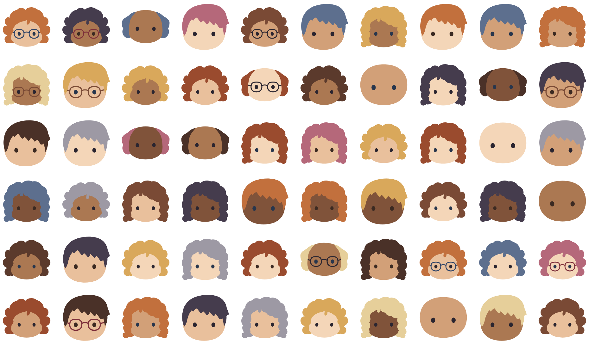
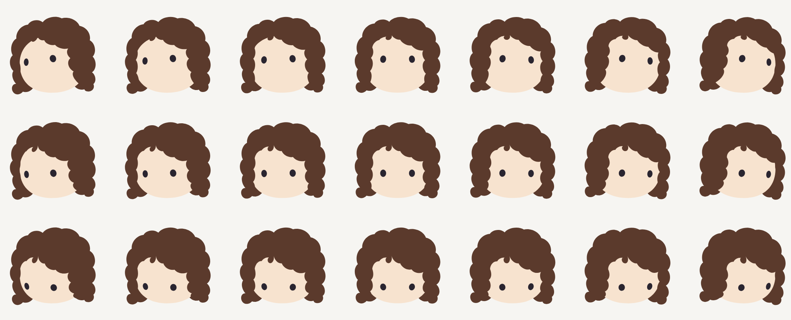

# 2DLiveBot

Animated character avatars for the web, drawn flat. An avatar is a soft, wide head with two dot
eyes, and hair and glasses on it. One string holds every setting of an avatar, and
mounting that string in a page makes the avatar live: it breathes, blinks, looks about, turns
its head and follows the pointer, and what it wears turns with it.

The library has no dependencies and loads nothing: every drawing is in its code. It builds its
SVG with DOM calls and moves it through SVG attributes, so it works under a content policy that
allows neither inline styles nor code from text.

It is on npm as [`@agentorg/2dlivebot`](https://www.npmjs.com/package/@agentorg/2dlivebot). The
catalog is small so far: the face, the eyes, four hair styles, each flat and known by its outline,
and a pair of glasses.





## The avatar's string

```
v1.round-f7e3cf.dot-2a2530.waves-5b3a2c.specs-2a2530
```

`v1` is the format. Each part follows a dot: its id, then each of its colours after a hyphen, as
six lowercase hex digits. The text uses only lowercase letters, digits, dots and hyphens, so it
goes into a URL, a JSON value or a file name as it is.

- `v1` alone is the plain avatar: the face and eyes, each in its own colour.
- An avatar has one part in each slot: `face`, `eyes`, `hair`, `eyewear`. A later part in a
  slot replaces an earlier one. A new slot joins at the end.
- `formatAvatar` writes the one string for an avatar: its parts in the slots' order, each with
  every colour. A string written by hand may leave colours out and list parts in any order.
- A string keeps drawing the same avatar: a part's id and drawing are permanent, and its colours
  are in the string.
- A part the catalog doesn't have is passed over, and a colour beyond those a part takes is
  ignored, so a string made with a later catalog still draws with an earlier one.

## Use

```
npm install @agentorg/2dlivebot
```

```ts
import { avatarFromSeed, mount, toSvg } from "@agentorg/2dlivebot";

// Live, in an element. A seed, such as a user's id, makes the same avatar every time.
const avatar = mount(element, { seed: user.id, size: 40 });
avatar.update({ value: "v1.round-e9c09c.dot-2a2530.waves-2d2630", size: 40 });
avatar.remove();

// Still, as SVG text: for an image, a file, or a page made on a server.
image.src = `data:image/svg+xml,${encodeURIComponent(toSvg(avatarFromSeed(user.id)))}`;
```

```tsx
import { Avatar } from "@agentorg/2dlivebot/react";

<Avatar seed={user.id} size={40} state="working" label={user.name} />;
```

`mount` and `Avatar` take the same options:

| Option  | What it sets                                                                             |
| ------- | ---------------------------------------------------------------------------------------- |
| `value` | The avatar's string. Text that is not one draws the plain avatar.                        |
| `seed`  | What to make the avatar from when there is no string.                                    |
| `size`  | Its width and height in CSS pixels. Without one it fills the element it is in.           |
| `still` | Stand still: as drawn, or turned the way `look` says.                                    |
| `look`  | Where it looks, `{ x, y }` from -1 to 1, right and down. Without one it looks by itself. |
| `state` | `"idle"`, `"working"` (reading something below it) or `"asleep"` (eyes closed).          |
| `label` | What a screen reader calls it. Without one it is hidden from screen readers.             |

A live avatar stops by itself while it is off screen, and stands still for a person who asks for
reduced motion. All the avatars in a page share one clock, which moves them 30 times a second and
redraws an avatar only when it would change by a quarter of a screen pixel. A picture is a
square that fits its figure, so an avatar with full hair is drawn a little smaller.

A seed chooses every part: a skin tone, the eyes' colour, one of the hair styles (`waves`, `mane`,
`sweep`, `sides`) or, for one head in twelve, none, a hair colour, and glasses (`specs`) for three
avatars in ten. Hair and frames are never a colour close to the skin's. `avatarFromSeed` returns
the string, so an avatar picked at random is the string of a random seed.

A seed makes the same avatar on every machine in one version of the library. A later version may
choose differently for some seeds. A string never changes what it draws, so an avatar that must
stay as it is is kept as its string.



`parseAvatar` reads a string into its settings and throws `AvatarStringError` for text that is
not one; `formatAvatar` writes settings back. `PARTS` and `SLOTS` list the catalog, for an editor.

## How it moves

The drawing is flat, and the head turns all the same. The face is treated as the shallow front
of a ball. When the head turns, every point that lies on the face travels round the ball: it
goes toward the side the head turns to, slows as it nears the edge, and what is drawn there
narrows. What is at the head's edge stays where it is, so nothing on the face ever crosses it.
The head's outline does not turn: it shifts and leans a little the same way.

That one rule gives each kind of thing its view of a turn:

- The eyes lie on the face, so the eye ahead closes on the edge and thins while the one behind
  crosses the middle. Glasses lie on the face too: each rim goes with its eye and narrows with
  it, and the arm on the side turned toward us lengthens.
- Hair is a shape whose rim stays with the head's outline and whose hairline lies on the face.
  In a turn the hairline goes with the face, so the hair between rim and hairline widens on the
  side turned toward us and thins on the side turned away, as the side of a head comes into
  view.



The eyes look first and the head follows most of the way on a spring, going a little past and
settling. The head stretches up as it breathes in and dips when it starts to turn. A blink
closes each eye onto its own middle.

## Parts

A part is one file under `src/parts/<slot>/`, listed in `src/parts/index.ts`. It has an id, a
slot, the colours it takes with their defaults, and layers. A layer has its place in the paint
order (`z`, from `Z` in `src/part.ts`) and flat shapes. Every layer rides the head as it shifts,
tilts and breathes.

A shape is a path in a 100 by 100 drawing space, drawn as the head looks from the front, in M,
L, C, Q and Z with absolute points. It is filled, drawn as a line, or both, with one of its
part's colours by position (`"0"`, `"1"`). Colour is flat: a part's character is its outline.

A path is written whole or in stretches. A plain stretch stays with the head's outline. A
stretch in `face()` lies on the face and turns with it:

```ts
d: [
  "M15 85C12 89.5 5.5 90 3 85.5 ... 84.5 86 84.5 84", // the rim, curl by curl
  face("C80.5 82 79 76 82.5 72 ... 20.5 79.5 16.5 82"), // the hairline
  "C16 83.2 15.5 84.2 15 85Z", // the rim again
],
```

A layer with `eye` is an eye, about that point: all of it lies on the face, it looks about by
itself, and it closes onto the point in a blink.

Every drawing in the catalog is original to this repository.

## Develop

```
npm ci
npm run build
npm test
npm run check
```

`npm run demo` builds the demo page and serves it at http://localhost:7745: an editor with the
parts, the colours and where the avatar looks, a sheet of that avatar turned each way, and
avatars from seeds. `?many=50` shows that many avatars and nothing else, and `&value=` with a
string makes them all that avatar. `npm run demo -- --build` builds the page into `dist/page`
and stops.

`npm publish` builds and tests first, so what it sends is always made from the files it is run
on.

## License

MIT. See [LICENSE](LICENSE).
